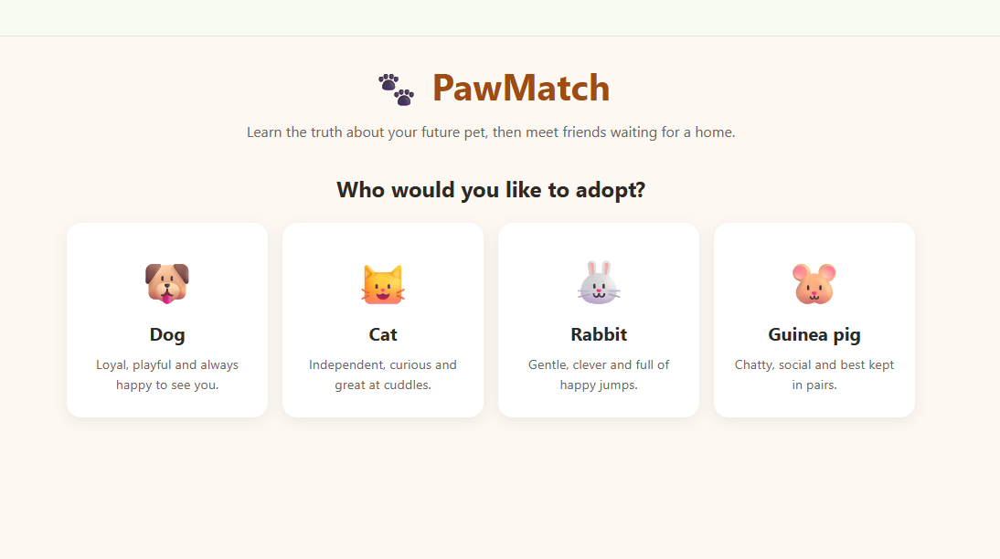
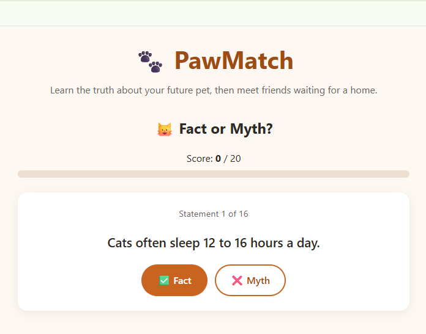

# 🐾 PawMatch

A friendly single-page app for future pet adopters. Pick an animal, play a quick
"Fact or Myth" game to learn the truth about it, and meet animals waiting
for a home in different shelters.

> This is a learning project; shelters and animals are fictional.

| Choose an animal | Fact or Myth game |
|---|---|
|  |  |

**Live demo:** https://nataliiadydykalo.github.io/PawMatch/

## Features

- Choose from 4 animals: dog, cat, rabbit, guinea pig
- "Fact or Myth" game with explanations, score and progress bar
- Reach 20 points to see up to 3 animals, each from a different shelter
- Loading, error and empty states
- Mobile-friendly design

## Tech stack

- Angular 21 (standalone components, signals, new control flow `@if` / `@for`)
- TypeScript (strict mode)
- SCSS
- Vitest for unit tests
- Mock data in JSON files, loaded with `HttpClient`

## How to run

Requirements: Node.js 20.19+, 22.12+ or 24+

```bash
git clone https://github.com/<your-username>/pawmatch.git
cd pawmatch
npm install
npm start
```

Open http://localhost:4200

Run tests:

```bash
npm test
```

## Project structure

```text
src/app/
├── app.ts / app.html        Root component: loads data and switches steps
├── pet-data.service.ts      Loads mock data with HttpClient
├── game-rules.ts            Points, shuffling, picking animals from different shelters
├── animal-picker/           Step 1: choose an animal
├── game/                    Step 2: Fact or Myth game
├── result/                  Step 3: matches
└── animal-card/             One animal card
public/mocks/                JSON mock data
```

## What I learned

- Building an Angular app with standalone components
- Managing state with `signal` and `computed`
- Passing data between components with `input()` and `output()`
- Using the new control flow: `@if`, `@for`, `@switch`
- Loading data with `HttpClient` and handling loading/error states
- Writing unit tests for pure functions with Vitest
- Responsive layouts with CSS Grid and SCSS
- Deploying an Angular app to GitHub Pages

## Possible improvements

- Save the best score in `localStorage`
- Ukrainian translation
- End-to-end tests with Playwright
- Connect a real API

## Author

Nataliia, [GitHub](https://github.com/<your-username>) · [LinkedIn](https://linkedin.com/in/<your-profile>)
